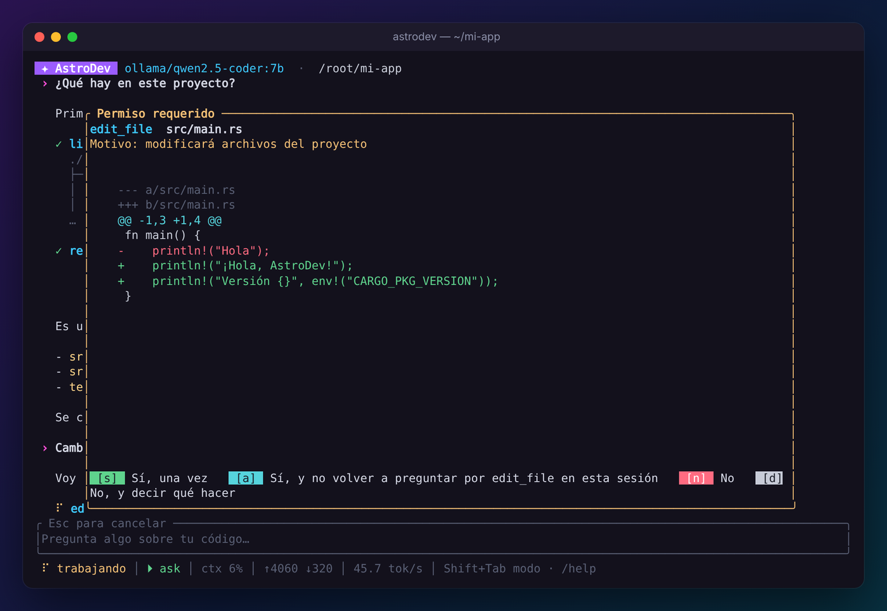
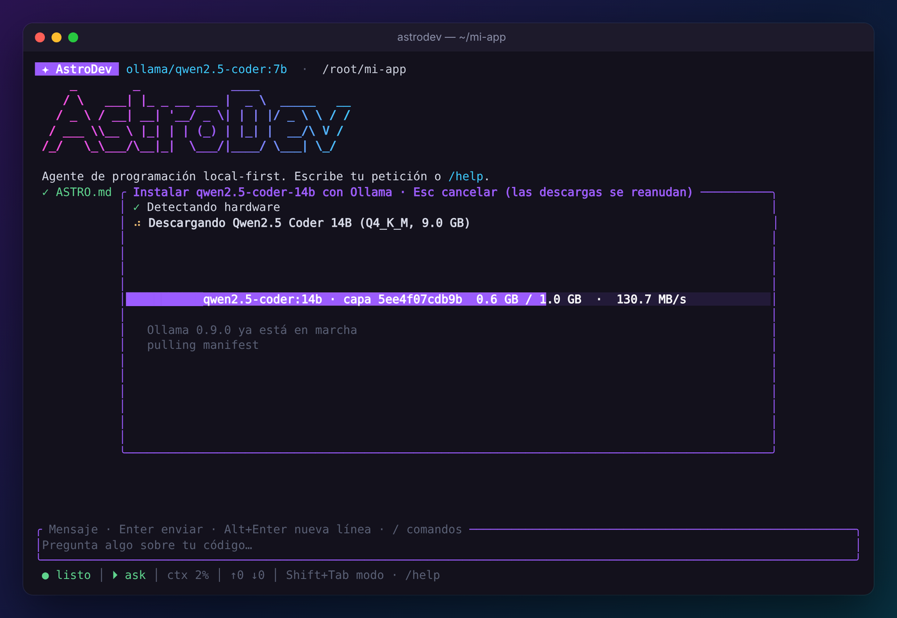

<p align="center">
  
</p>

<p align="center">
  <b>Un agente de programación para tu terminal.</b> Local-first, open source y multiplataforma.<br>
  Funciona con modelos locales (Ollama, llama.cpp, LM Studio, vLLM) y con APIs (Claude, GPT, Gemini, OpenRouter, Groq, DeepSeek, Mistral).
</p>

<p align="center">
  <a href="https://github.com/AstroSoftwareMoon/AstroCode/actions/workflows/ci.yml"></a>
  
  
  
  
</p>

<p align="center">
  
</p>

## Instalación

**Linux y macOS**

```bash
curl -fsSL https://raw.githubusercontent.com/AstroSoftwareMoon/AstroCode/main/scripts/install.sh | sh
```

**Windows (PowerShell)**

```powershell
irm https://raw.githubusercontent.com/AstroSoftwareMoon/AstroCode/main/scripts/install.ps1 | iex
```

Los instaladores descargan el binario de la última release, **verifican su SHA-256** y lo dejan en
`~/.local/bin` (o `%LOCALAPPDATA%\astrodev\bin`). No necesitan permisos de administrador.

¿Prefieres compilarlo? `cargo install --git https://github.com/AstroSoftwareMoon/AstroCode astrodev`

## Primeros pasos

```bash
cd tu-proyecto
astrodev
```

La primera vez se abre un asistente de 4 pasos que funciona sin leer documentación:

1. **Detecta tu hardware** (CPU, RAM, GPU/VRAM, disco).
2. **Eliges** modelos locales, una API, o ambos.
3. **Recomienda e instala** el mejor modelo que cabe en tu equipo (instala Ollama si hace falta, descarga el modelo, hace un test de humo y ajusta el contexto).
4. **Abre el proyecto** y, si quieres, crea un `ASTRO.md` con su contexto.

<p align="center"></p>

## Qué hace

### Un agente que trabaja en tu código

Lee, busca, edita archivos con diffs, ejecuta comandos y git, e itera hasta terminar.
Cada cambio se previsualiza y **tú decides**.

<p align="center"></p>

### Permisos claros

Tres modos (`Shift+Tab` para cambiar): **ask** (pregunta siempre), **auto-project** (ediciones
automáticas dentro del proyecto) y **auto-all**. Los comandos peligrosos (`rm -rf`, `git push --force`,
`curl … | sh`, `sudo`…) y cualquier acceso **fuera del proyecto** piden confirmación en todos los modos.

<p align="center"></p>

### Sabe qué modelos te caben

`/hardware` calcula la memoria de cada modelo (pesos GGUF + KV cache según el contexto + margen),
estima los tokens/s por el ancho de banda de tu GPU o CPU y lo clasifica en
**recomendado / posible / demasiado grande**. El catálogo se actualiza desde este repositorio sin tocar el binario.

<p align="center"></p>
<p align="center"><sub>Captura con hardware simulado (RTX 4070 12 GB) mediante <code>ASTRODEV_HW_OVERRIDE</code>.</sub></p>

### Instala por ti

Instala Ollama o llama.cpp con la build correcta (CUDA, ROCm/HIP, Metal, Vulkan o CPU), descarga
modelos con barra de progreso y **reanudación**, verifica hashes, controla el espacio libre y, al acabar,
mide la velocidad y ajusta el contexto para que el modelo quede entero en la GPU.

<p align="center"></p>

### Y además

- **Cualquier modelo**: Ollama, llama.cpp, LM Studio, vLLM, cualquier endpoint compatible con OpenAI, Anthropic, Google Gemini, OpenRouter, Groq, DeepSeek y Mistral. Añádelos con `/provider add`.
- **Claves seguras**: en el keyring del sistema (Keychain, Credential Manager, Secret Service), nunca en texto plano.
- **Modelos pequeños bien soportados**: si el modelo no tiene tool calling nativo, AstroDev usa un formato por prompt con un parser tolerante (repara JSON roto) y reintentos.
- **Perfiles por tarea** (planificar, editar, resumir) y **fallback** automático si un modelo falla.
- **Sesiones** guardadas y reanudables (`/resume`, `astrodev -c`), **`/undo`** que restaura archivos y conversación, **resumen automático** del contexto.
- **Streaming, cancelación (Esc), reintentos con backoff** y conteo de tokens y coste (`/cost`).
- **Cero telemetría.** Los logs se quedan en tu máquina (`--debug` para más detalle).

## Comandos

| En la TUI | |
|---|---|
| `/model [proveedor/]modelo` | cambiar de modelo (sin argumento, lista los disponibles) |
| `/provider add · list · remove` | gestionar proveedores y APIs |
| `/hardware` · `/install` · `/uninstall` | recomendador e instalador de modelos locales |
| `/permissions` · `Shift+Tab` | modo de permisos |
| `/undo` · `/resume` · `/clear` | deshacer, reanudar sesión, nueva conversación |
| `/compact` · `/context` · `/cost` | contexto y coste |
| `/init` · `/setup` · `/help` | crear ASTRO.md, asistente inicial, ayuda |

| En la terminal | |
|---|---|
| `astrodev -p "…"` | un único prompt sin TUI (permisos con `--mode`) |
| `astrodev -c` / `--resume <id>` | reanudar la última sesión o una concreta |
| `astrodev hardware` · `recommend` | hardware y modelos recomendados (`--json`) |
| `astrodev pull <modelo>` · `rm` · `install ollama\|llamacpp` | instalar y borrar modelos y runtimes |
| `astrodev provider add\|list\|remove\|test` | proveedores |
| `astrodev sessions` · `catalog update` · `smoke-test` · `config path` | utilidades |

## Contexto del proyecto: `ASTRO.md`

Igual que `CLAUDE.md`: un archivo en la raíz con convenciones, cómo compilar y probar, y lo que el
agente deba saber. Se añade a cada conversación. `/init` lo genera analizando el proyecto.

## Configuración

`~/.config/astrodev/config.toml` (Linux), `~/Library/Application Support/dev.astrodev.astrodev/` (macOS)
o `%APPDATA%\astrodev\astrodev\config\` (Windows). Mira la ruta con `astrodev config path` y todas las
opciones en [docs/CONFIG.md](docs/CONFIG.md).

## Arquitectura

Workspace de Rust con crates independientes: `core` (agente, permisos, sesiones), `providers`, `tools`,
`hardware`, `installer` y `tui`. Detalles en [docs/ARCHITECTURE.md](docs/ARCHITECTURE.md).

## Contribuir

¡Bienvenido! Lee [CONTRIBUTING.md](CONTRIBUTING.md). Proponer modelos para el catálogo es tan fácil como
editar [`catalog/models.json`](catalog/models.json).

## Licencia

[MIT](LICENSE)
